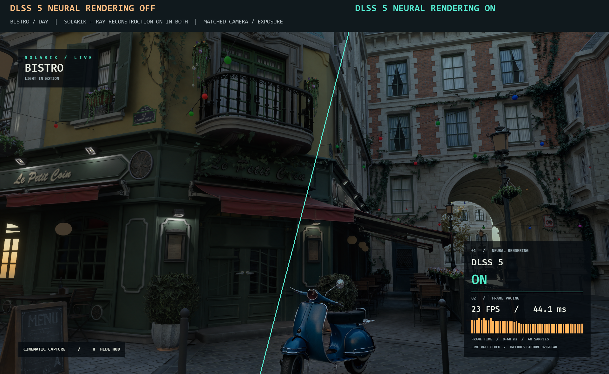
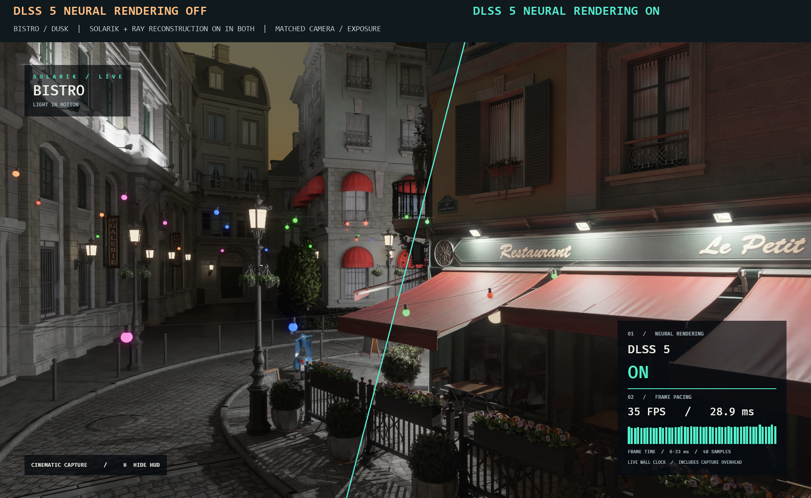
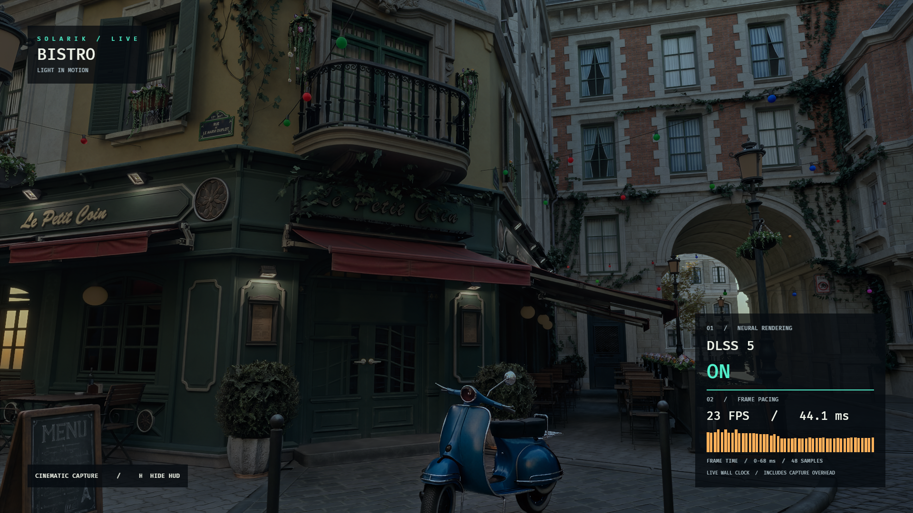
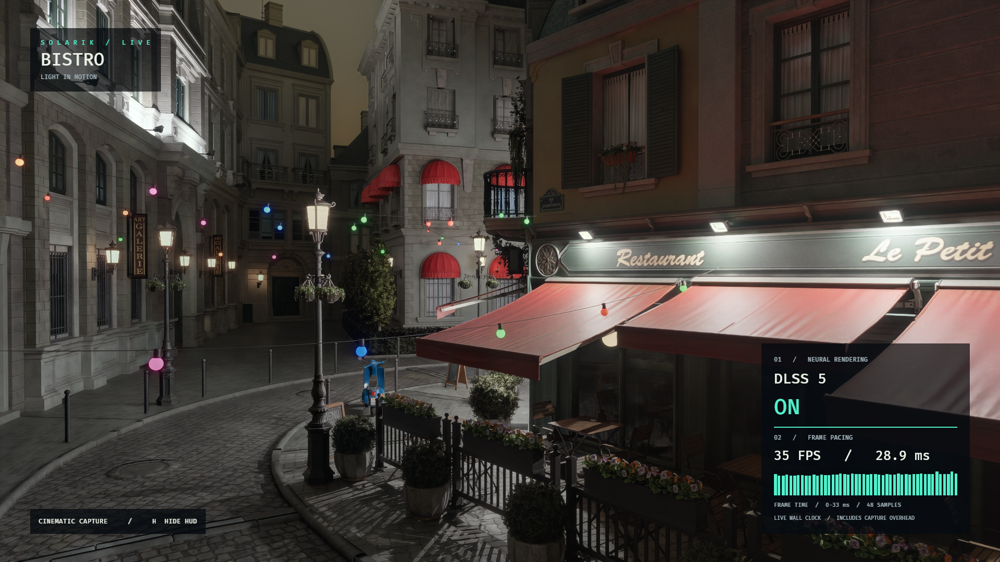

# bevy_dlss5

DLSS 5 Neural Rendering for Bevy 0.19.1. It adds neural lighting detail to the rendered image using NGX feature 18, with the camera's depth and motion vectors.

This is experimental. It has been tested on Windows with an RTX 4090 and Vulkan, using a DLL built for that GPU. The runtime setup has a few quirks; read [Requirements](#requirements) before trying it.

[Releases](https://github.com/AlrikOlson/bevy_dlss5/releases) · [Changelog](CHANGELOG.md) · [Contributing](CONTRIBUTING.md)

## What it looks like

**Left: DLSS 5 Neural Rendering OFF. Right: DLSS 5 Neural Rendering ON.**
Solarik ray-traced lighting and DLSS Ray Reconstruction remain **ON in both
halves**. These are native 1920×1080 Bevy 0.19.1 captures, with no upscaling.
The diagonal split keeps the same camera, lighting, exposure and warm-up
settings. The lower-right HUD belongs to the ON capture. Separate runs retain
some stochastic lighting variation; this is a visual comparison rather than a
pixel-exact measurement of Neural Rendering alone.

**Day — Neural Rendering OFF / ON**



**Dusk — Neural Rendering OFF / ON**



<details>
<summary>Full screenshots — DLSS 5 Neural Rendering ON, with HUD</summary>

**Day — DLSS 5 Neural Rendering ON**



**Dusk — DLSS 5 Neural Rendering ON**



</details>

The HUD reports live backend status, FPS and application frame times. Timings
include capture overhead; these images are not an ON/OFF performance comparison.
Refreshed September 6, 2026 with Solarik `cc1f9e6` (GI foliage endpoints)
and playground `90f532a`, including the matching Bistro interior. These use
frames 750 (day) and 1520 (dusk) of the 1,800-frame timeline, with 512 and
1,024 fixed-pose warmup frames respectively. Scene exposure, lights and fog/blur
use the preset; additional grading is disabled. Shadow variation and soft
foliage remain. [Capture settings and settling checks](docs/captures.md)
document the refreshed images.

Scene: [Amazon Lumberyard Bistro, via NVIDIA ORCA](https://developer.nvidia.com/orca/amazon-lumberyard-bistro),
[CC BY 4.0](https://creativecommons.org/licenses/by/4.0/), using the
[qian-o glTF conversion](https://github.com/qian-o/GLTF-Assets).

## Usage

Add the tagged version to your `Cargo.toml`:

```toml
[dependencies]
bevy = "0.19.1"
bevy_dlss5 = { git = "https://github.com/AlrikOlson/bevy_dlss5", tag = "v0.1.1" }
```

Add the plugin before `DefaultPlugins`, then put the component on your camera:

```rust,ignore
use bevy::prelude::*;
use bevy_dlss5::{DlssNeuralRenderingPlugin, DlssNeuralRendering};

fn main() {
    App::new()
        // has to go BEFORE DefaultPlugins, it adds Vulkan device extensions
        .add_plugins(DlssNeuralRenderingPlugin::default())
        .add_plugins(DefaultPlugins)
        .add_systems(Startup, setup)
        .run();
}

fn setup(mut commands: Commands) {
    commands.spawn((
        Camera3d::default(),
        DlssNeuralRendering::default(), // pulls in Hdr + DepthPrepass + MotionVectorPrepass for you
        bevy::anti_alias::taa::TemporalAntiAliasing::default(),
        Msaa::Off, // MSAA doesn't work with the in-place write, use TAA
        Transform::from_xyz(0.0, 1.0, 4.0).looking_at(Vec3::ZERO, Vec3::Y),
    ));
}
```

Knobs on the component, can be changed at runtime:

```rust,ignore
DlssNeuralRendering {
    intensity: 1.0,   // overall strength
    tone: 0.0,        // broad lighting change, keep low
    structure: 1.6,   // AO / contact shadows / micro reflections, this is the visible part
    preset: bevy_dlss5::DlssNrPreset::Auto,
    reset: false,     // set true for one frame on a camera cut, like TemporalAntiAliasing::reset
}
```

Temporal history is kept between frames using Bevy's motion vectors. Set `reset` on a camera cut; it clears itself after one frame.

Remove the component to turn it off. `DlssNeuralRenderingStatus` is a resource you can read to see if it actually came up:

```rust,ignore
fn hud(status: Res<bevy_dlss5::DlssNeuralRenderingStatus>) {
    if status.is_active() { /* running */ }
    if status.is_unavailable() { /* nope, check the log */ }
}
```

## Requirements

The current integration uses the Windows NGX library.

1. **Vulkan.** Set `WGPU_BACKEND=vulkan` or force `Backends::VULKAN` in `RenderPlugin`. On any other backend the plugin just disables itself.

2. **A `nvngx_dlssnr.dll` built for your GPU architecture.** The neural kernels inside are compiled GPU code, so a Blackwell DLL will not run on an Ada card no matter what you patch. The community builds come in this layout and the plugin picks the right one from your adapter name:

   ```
   dlssnr/
     Turing+/nvngx_dlssnr.dll        # RTX 20/30, GTX 16
     Ada Lovelace+/nvngx_dlssnr.dll  # RTX 40
     Blackwell+/nvngx_dlssnr.dll     # RTX 50 (this is the unmodified NVIDIA one)
   ```

   Drop that `dlssnr/` folder next to your exe (or a single `nvngx_dlssnr.dll` next to it) and `DlssNeuralRenderingPlugin::default()` finds it. Not included here, bring your own. You can also point at a file or folder explicitly:

   ```rust,ignore
   DlssNeuralRenderingPlugin::with_dll("path/to/nvngx_dlssnr.dll");
   DlssNeuralRenderingPlugin::with_arch_dir("assets/dlssnr");
   ```

3. **Your exe has to be called `nvngx.dll`.** Yes really. The NGX snippet checks the name of the process image and refuses to init otherwise (`0xBAD00002`). Loading a dll with that name doesn't fool it, it has to be the main executable. For dev:

   ```powershell
   cargo build --release
   copy target\release\my_game.exe target\release\nvngx.dll
   target\release\nvngx.dll
   ```

4. **The NGX SDK at build time.** Set `DLSS_SDK` to a checkout of https://github.com/NVIDIA/DLSS so `build.rs` can link `nvsdk_ngx_d.lib`. `cargo check` works without it, linking a binary doesn't. No bindgen, no clang, no Vulkan SDK needed.

If runtime initialization fails, the plugin logs a warning and the game continues without NR. A missing SDK at link time is a build error.

The [minimal example](examples/minimal.rs) creates a small scene and lets you toggle NR with **N**. Build it with `cargo build --release --example minimal`, then follow the runtime setup above for the binary in `target/release/examples/`.

## How it works

- `build()` registers a `raw_vulkan_init` callback that enables `VK_NVX_binary_import`, `VK_NVX_image_view_handle`, `VK_KHR_push_descriptor`, `VK_KHR_maintenance4` and buffer device address. That's why the plugin has to be added before `DefaultPlugins`.
- `finish()` adds a render graph system in `Core3d`'s post process set, ordered after tonemapping. It runs once per camera with the component and writes the result back into the camera's main texture in place (no ping pong, which was causing a 2 frame flicker).
- Feature 18 wants gamma encoded display-referred color, Bevy's post tonemap texture is linear. Two tiny compute passes convert to sRGB before and back to linear after. Skip this and you get red hallucinations everywhere.
- The "after tonemapping" part matters. An earlier version had no ordering constraint, the scheduler ran the node before tonemapping, and the sRGB pass clamped the HDR frame at linear 1.0. Nothing on the NR side could get brighter than what the tonemapper makes of 1.0 (about 198/255 with TonyMcMapface), so emissives, bloom and sun patches all came out dimmer than with NR off. If you fork this, keep the `.after(tonemapping)`.
- Depth and motion vectors come from the prepasses the component requires.

## About patching the DLL

`bevy_dlss5::patch` and the `dlss5-patch` binary reproduce the two byte patches people use to skip the "is this Blackwell" check:

```
dlss5-patch <genuine nvngx_dlssnr.dll> [output.dll]
```

I tried this on the real NVIDIA DLL on a 4090 so you don't have to: the check passes, then kernel load fails with `vkCreateCuModuleNVX ... failed` because the cubins are Blackwell code. The patch is only useful on a DLL that already has kernels for your GPU. Use the per-architecture DLLs instead.

## Known issues

- Only Windows, Vulkan and an RTX 4090 have been tested here. The DLL folder names above are selection rules, not a list of tested GPUs.
- Feature handles are only freed on resolution change or exit. Spawning and despawning lots of NR cameras leaks.
- The tone parameter mostly does nothing with the fallback preset. Control brightness with scene exposure.
- NR pulls some fully blown highlights down a little (a neon sign at 255 may come back at 240). That's the network doing photographic highlight handling, not clipping; a zero-strength pass reproduces the input exactly.

## License

[MIT](LICENSE-MIT) or [Apache-2.0](LICENSE-APACHE), your pick. The NGX SDK and runtime DLLs have separate NVIDIA terms and are not included here. The Bistro screenshots use the Amazon Lumberyard Bistro scene from NVIDIA ORCA, licensed under CC BY 4.0.
