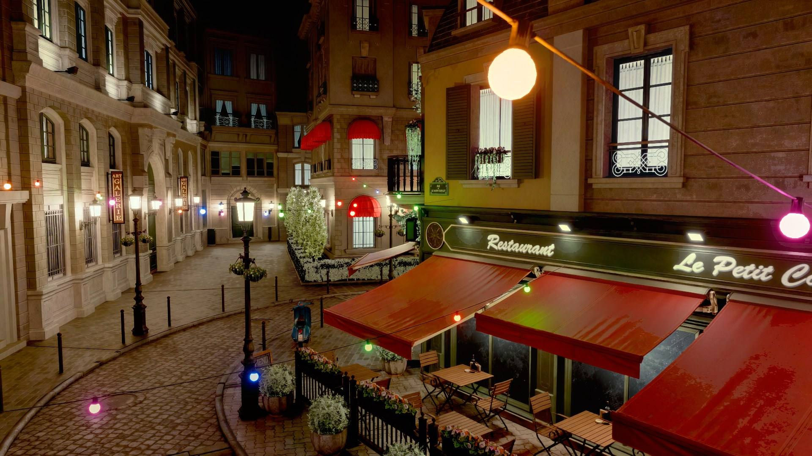
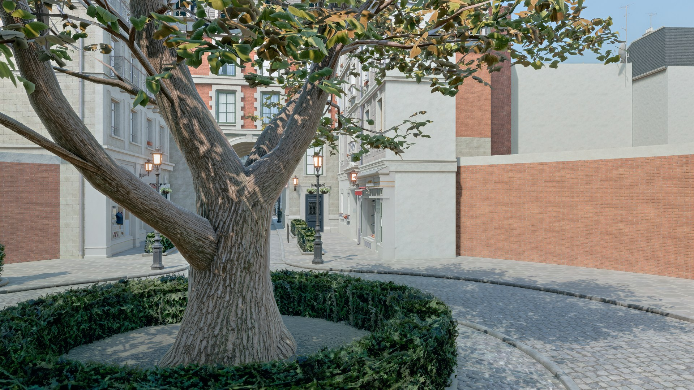

# bevy_dlss5

DLSS 5 Neural Rendering (NGX feature 18) as a Bevy 0.19 plugin.

Neural Rendering is the new DLSS 5 thing that re-lights your frame with a neural net: it adds contact shadows, ambient occlusion, small reflections, more material detail. It is not an upscaler and not an anti-aliaser, it's a post process that runs on the final HDR frame plus depth and motion vectors.

NVIDIA ships it for RTX 50 only. This plugin runs it on RTX 40 too (tested on a 4090), see the requirements section for the catch.

## What it looks like

Both frames are Bevy 0.19 with Neural Rendering on, from `bevy-sponza`, the test rig the plugin was built against, 1080p, no upscaling. Scene: Amazon Lumberyard Bistro, via NVIDIA ORCA (CC BY 4.0).



Night, lit by the lamp glass and string lights only: Bevy Solari ray tracing, DLSS Ray Reconstruction as the denoiser, then Neural Rendering on top. Two DLSS clients in one process, it works.



Day, the ordinary raster path (shadow maps, SSAO, SSR) with Neural Rendering. The contact shadows under the leaves and in the hedge are the network's.

## Usage

```rust,ignore
use bevy::prelude::*;
use bevy_dlss5::{DlssNeuralRenderingPlugin, DlssNeuralRendering};

fn main() {
    App::new()
        // has to go BEFORE DefaultPlugins, it adds Vulkan device extensions
        .add_plugins(DlssNeuralRenderingPlugin::default())
        .add_plugins(DefaultPlugins)
        .add_systems(Startup, setup)
        .run();
}

fn setup(mut commands: Commands) {
    commands.spawn((
        Camera3d::default(),
        DlssNeuralRendering::default(), // pulls in Hdr + DepthPrepass + MotionVectorPrepass for you
        bevy::anti_alias::taa::TemporalAntiAliasing::default(),
        Msaa::Off, // MSAA doesn't work with the in-place write, use TAA
        Transform::from_xyz(0.0, 1.0, 4.0).looking_at(Vec3::ZERO, Vec3::Y),
    ));
}
```

Knobs on the component, can be changed at runtime:

```rust,ignore
DlssNeuralRendering {
    intensity: 1.0,   // overall strength
    tone: 0.0,        // broad lighting change, keep low
    structure: 1.6,   // AO / contact shadows / micro reflections, this is the visible part
    preset: bevy_dlss5::DlssNrPreset::Auto,
    reset: false,     // set true for one frame on a camera cut, like TemporalAntiAliasing::reset
}
```

Temporal history is kept between frames (it's stable with Bevy's motion vectors, no ghosting on a moving camera); `reset` drops it for one frame and clears itself.

Remove the component to turn it off. `DlssNeuralRenderingStatus` is a resource you can read to see if it actually came up:

```rust,ignore
fn hud(status: Res<bevy_dlss5::DlssNeuralRenderingStatus>) {
    if status.is_active() { /* running */ }
    if status.is_unavailable() { /* nope, check the log */ }
}
```

## Requirements

This is the annoying part.

1. **Vulkan.** Set `WGPU_BACKEND=vulkan` or force `Backends::VULKAN` in `RenderPlugin`. On any other backend the plugin just disables itself.

2. **A `nvngx_dlssnr.dll` built for your GPU architecture.** The neural kernels inside are compiled GPU code, so a Blackwell DLL will not run on an Ada card no matter what you patch. The community builds come in this layout and the plugin picks the right one from your adapter name:

   ```
   dlssnr/
     Turing+/nvngx_dlssnr.dll        # RTX 20/30, GTX 16
     Ada Lovelace+/nvngx_dlssnr.dll  # RTX 40
     Blackwell+/nvngx_dlssnr.dll     # RTX 50 (this is the unmodified NVIDIA one)
   ```

   Drop that `dlssnr/` folder next to your exe (or a single `nvngx_dlssnr.dll` next to it) and `DlssNeuralRenderingPlugin::default()` finds it. Not included here, bring your own. You can also point at a file or folder explicitly:

   ```rust,ignore
   DlssNeuralRenderingPlugin::with_dll("path/to/nvngx_dlssnr.dll");
   DlssNeuralRenderingPlugin::with_arch_dir("assets/dlssnr");
   ```

3. **Your exe has to be called `nvngx.dll`.** Yes really. The NGX snippet checks the name of the process image and refuses to init otherwise (`0xBAD00002`). Loading a dll with that name doesn't fool it, it has to be the main executable. For dev:

   ```powershell
   cargo build --release
   copy target\release\my_game.exe target\release\nvngx.dll
   target\release\nvngx.dll
   ```

4. **The NGX SDK at build time.** Set `DLSS_SDK` to a checkout of https://github.com/NVIDIA/DLSS so `build.rs` can link `nvsdk_ngx_d.lib`. `cargo check` works without it, linking a binary doesn't. No bindgen, no clang, no Vulkan SDK needed.

If any of this is missing you get one warning in the log and your game runs normally without NR.

## How it works

- `build()` registers a `raw_vulkan_init` callback that enables `VK_NVX_binary_import`, `VK_NVX_image_view_handle`, `VK_KHR_push_descriptor`, `VK_KHR_maintenance4` and buffer device address. That's why the plugin has to be added before `DefaultPlugins`.
- `finish()` adds a render graph system in `Core3d`'s post process set, ordered after tonemapping. It runs once per camera with the component and writes the result back into the camera's main texture in place (no ping pong, which was causing a 2 frame flicker).
- Feature 18 wants gamma encoded display-referred color, Bevy's post tonemap texture is linear. Two tiny compute passes convert to sRGB before and back to linear after. Skip this and you get red hallucinations everywhere.
- The "after tonemapping" part matters. An earlier version had no ordering constraint, the scheduler ran the node before tonemapping, and the sRGB pass clamped the HDR frame at linear 1.0. Nothing on the NR side could get brighter than what the tonemapper makes of 1.0 (about 198/255 with TonyMcMapface), so emissives, bloom and sun patches all came out dimmer than with NR off. If you fork this, keep the `.after(tonemapping)`.
- Depth and motion vectors come from the prepasses the component requires.

## About patching the DLL

`bevy_dlss5::patch` and the `dlss5-patch` binary reproduce the two byte patches people use to skip the "is this Blackwell" check:

```
dlss5-patch <genuine nvngx_dlssnr.dll> [output.dll]
```

I tried this on the real NVIDIA DLL on a 4090 so you don't have to: the check passes, then kernel load fails with `vkCreateCuModuleNVX ... failed` because the cubins are Blackwell code. The patch is only useful on a DLL that already has kernels for your GPU. Use the per-architecture DLLs instead.

## Known issues

- Feature handles are only freed on resolution change or exit. Spawning and despawning lots of NR cameras leaks.
- The tone parameter mostly does nothing with the fallback preset. Control brightness with scene exposure.
- NR pulls some fully blown highlights down a little (a neon sign at 255 may come back at 240). That's the network doing photographic highlight handling, not clipping; a zero-strength pass reproduces the input exactly.

## License

MIT or Apache-2.0, your pick. The `nvngx_dlssnr.dll` and NGX SDK are NVIDIA's and under NVIDIA's terms, nothing of theirs is in this repo.
